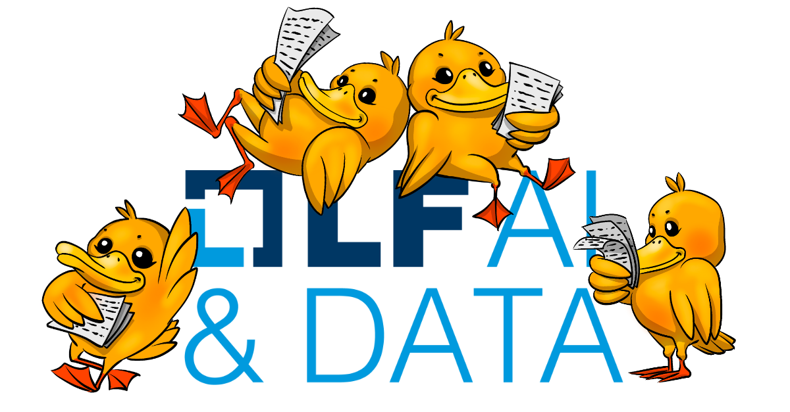
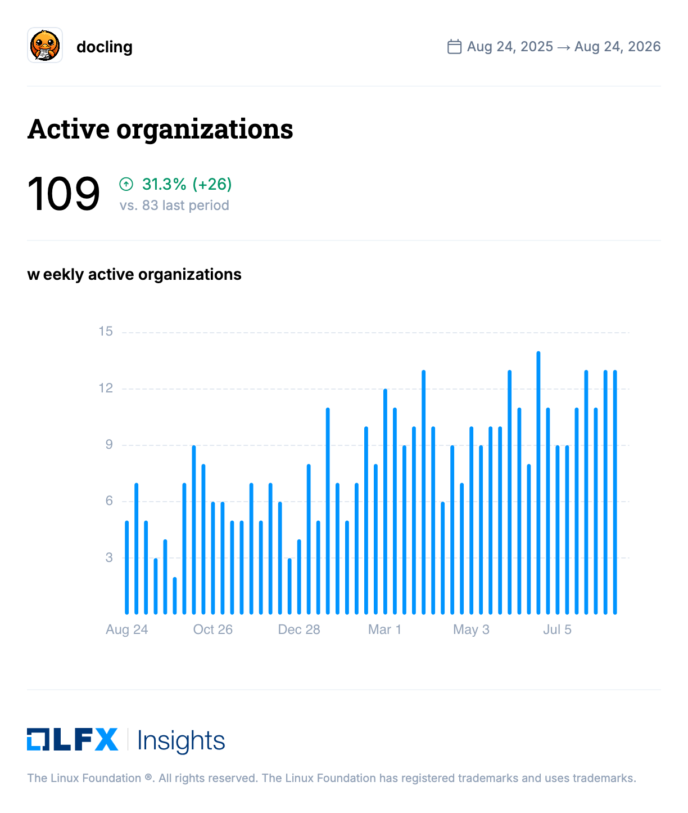
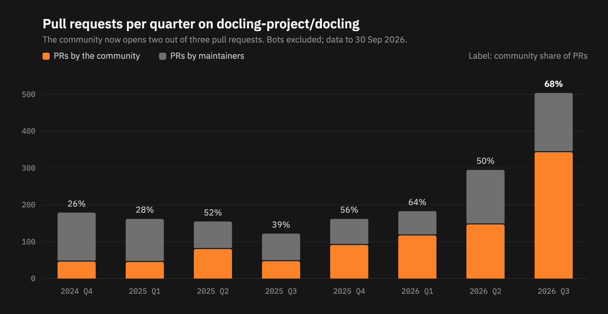

## Docling is now a Graduated project

On **August 27, 2026**, Docling became a **Graduated project** of the [LF AI & Data Foundation](https://lfaidata.foundation/projects/). Graduation is the top stage of the foundation's project lifecycle. It means a project has a healthy, diverse contributor base, mature engineering practices and open governance that does not depend on any single company.

Two years ago Docling was a research release from IBM Research Zurich. Today it is the document layer behind RAG pipelines, extraction workflows and agents at companies, universities and public institutions around the world. Graduation is the foundation's recognition of that journey, but most of all it recognizes the people who made it possible: **the Docling community**.

## From a research release to open governance

The road to graduation, in short:

- **July 2024:** IBM Research open-sources Docling. Within months it is the #1 trending repository on GitHub.
- **March 2025:** IBM contributes Docling to the LF AI & Data Foundation as an incubation project. Code, name and roadmap move to open governance, with a Technical Steering Committee, a public roadmap and a [governance model](https://github.com/docling-project/community/blob/main/GOVERNANCE.md) where any contributor can become a committer.
- **April 2025:** Docling earns the OpenSSF Best Practices **Silver** badge.
- **2025–2026:** Open governance at work. Docling MCP, Granite-Docling, ASR, chart understanding, a hardened `docling-parse` and [Docling for IBM watsonx](https://www.ibm.com/products/docling), all built in the open. The contributor base grows quarter after quarter: more than 400 people outside the maintainer team have now opened a pull request on the main repository.
- **2026:** The first committers from outside the original core team join: [Georg Heiler](https://github.com/geoheil) and [Nguyen Hoang Duong](https://github.com/DanielNg0729), both voted in by the TSC under the project's open governance rules.
- **July 2026:** Peter Staar, chair of Docling's TSC, is elected chair of the foundation's Technical Advisory Council (TAC).
- **August 2026:** Docling earns the OpenSSF Best Practices **Gold** badge.
- **August 27, 2026:** Docling graduates.

## The graduation scorecard

Graduation is not a popularity contest. The LF AI & Data Foundation has a concrete set of criteria, and the TAC reviews each of them before voting. This is the scorecard we presented:

| Criterion | Where Docling stands |
| --- | --- |
| Code contributions from at least five organizations | **109** active organizations in the last 12 months ([LFX Insights](https://insights.linuxfoundation.org/project/docling)) |
| At least 1,000 GitHub stars | **65k+** stars at the time of the vote |
| OpenSSF Best Practices Gold badge, achieved and maintained | **Gold** since August 2026, Silver since April 2025 ([bestpractices.dev](https://www.bestpractices.dev/en/projects/10101)) |
| Substantial flow of commits and merged contributions over 12 months | **2,154** pull requests merged in 12 months (LFX Insights) |
| At least one collaboration with another LF AI & Data project | Project Explorer in the MLOps working group, active collaborations with **OpenSearch** and **Milvus** |
| A technical lead representing the project on the TAC | **Michele Dolfi** represents Docling on the TAC |

Every line on that table is a community result. Five organizations was the bar; more than a hundred cleared it.

## The community got us here

When we open-sourced Docling, we hoped people would find it useful. We did not expect how quickly users would turn into contributors.

**Year one was about issues.** People tried Docling on their own documents and told us what broke: odd PDFs, missing formats, tables that came out wrong. Issues peaked at 360 in a single quarter in spring 2025. Those reports shaped the roadmap more than any plan we wrote.

**Year two was about pull requests.** The same people started fixing things themselves. New backends, OCR engines, format support, performance fixes and documentation now arrive as PRs. At the end of 2024, about a quarter of the pull requests on the main repository came from outside the maintainer team. In the third quarter of 2026 it was **68%**, from **154** different community authors in that quarter alone.

The numbers behind that shift, on graduation day:

- **65k+** GitHub stars on the main repository
- **20M+** downloads a month from PyPI, including mirrors
- **406** people outside the maintainer team have opened a pull request on the main repository
- **109** organizations actively contributing over the last 12 months

Contributors also take on responsibility in the project itself. Our governance lets any contributor be nominated as a committer, and the TSC has now voted in the first two committers from outside the original core team: [Georg Heiler](https://github.com/geoheil) and [Nguyen Hoang Duong](https://github.com/DanielNg0729), whose track record of [merged pull requests](https://github.com/docling-project/docling/issues?q=is%3Apr%20author%3ADanielNg0729) earned the nomination. Committers can commit directly and share the duty of leading the community. Community members also maintain whole subprojects, as you will see below.

### An ecosystem, not a repository

Docling is no longer one repository. Some of the most important pieces were started and are maintained by the community:

- **[Docling Java](https://github.com/docling-project/docling-java)** brings Docling to the JVM. It was bootstrapped and is actively maintained by external contributors.
- **[docling.rs](https://github.com/docling-project/docling.rs)** is a Rust port of Docling, also bootstrapped and maintained by external contributors.
- **[Docling Graph](https://github.com/docling-project/docling-graph)** turns documents into validated knowledge graphs. IBM donated it to the project as a Docling subproject.

Around them, Docling is built into the frameworks people already use, including LangChain, LlamaIndex, Haystack and Langflow, and runs behind MCP servers and agent skills in coding assistants and agent harnesses.

### Office hours, by the community

Our community office hours have grown into a regular meeting place, often with **more than 100 attendees**. Many sessions feature invited talks from people building on Docling: teams at IBM and Red Hat, Java Champions Thomas Vitale and Eric Deandrea on Docling for Java, the IBM Granite team, founders and researchers using Docling in production. Hearing how others use the project is one of the best parts of maintaining it.

## What graduation changes, and what it doesn't

For users, nothing breaks: `pip install docling` works exactly as before, and the license stays MIT.

What graduation adds is confidence. Docling is a vendor-neutral project with open governance, mature security practices and a contributor base spread across more than a hundred organizations. If you are choosing a document layer for systems that need to last, that matters.

It also sets a direction. In his post on [building the context layer for AI in the open](https://lfaidata.foundation/blog/), Peter Staar put it simply: "AI needs an open language for context." Docling is one building block of that context layer. [DocLang](https://doclang.ai), the open document format now developed under LF AI & Data, is another.

## What's next

Graduation is a milestone, not a finish line. Some of what we are working on next, together with the community:

- **Document-aware evaluation:** open metrics and datasets that understand layout, tables and reading order, through docling-eval and docling-metrics.
- **Open benchmarks:** reproducible results against other parsers and VLMs.
- **A new Granite-Docling generation** that speaks DocLang natively.
- **More agentic and extraction use cases** with MCP, agent skills and Docling Agent.
- **Scaling review:** the volume of contributions keeps growing, much of it AI-assisted. Clear guidelines, CI and triage automation now matter as much as code, and we want contributing to Docling to stay a good experience.

## Thank you

To everyone who filed an issue, opened a pull request, answered a question, wrote a blog post, gave a talk at office hours, built an integration or simply starred the repository: **thank you**. Docling graduated because of you.

And because a graduation deserves a celebration, we wrote Docling a song. Here is *Every page in place*, short version:

<iframe src="https://www.youtube-nocookie.com/embed/SzISTBp7A3k" title="Docling song: Every page in place (short)" style="position: absolute; inset: 0; width: 100%; height: 100%; border: 0; border-radius: 8px;" allow="accelerometer; clipboard-write; encrypted-media; gyroscope; picture-in-picture; web-share" referrerpolicy="strict-origin-when-cross-origin" allowfullscreen></iframe>

If you want the whole thing, the [full version](https://youtu.be/AdrVoB_ZPPQ) is on our YouTube channel.

If you are not yet part of the community, this is a great time to join:

- ⭐ Star and contribute on [GitHub](https://github.com/docling-project/docling)
- 💬 Join the conversation on the [LF AI & Data Slack](https://communityinviter.com/apps/lfaifoundation/join-lf-ai-and-data-foundation) in `#docling-technical-discuss`
- 📅 Come to the next office hours: see the [community page](/community/)
- 📺 Watch past sessions on [YouTube](https://www.youtube.com/@Docling-AI)

## Resources

- [Docling on GitHub](https://github.com/docling-project/docling)
- [Docling Documentation](https://docling-project.github.io/docling/)
- [LF AI & Data Foundation projects](https://lfaidata.foundation/projects/)
- [Docling on LFX Insights](https://insights.linuxfoundation.org/project/docling)
- [OpenSSF Best Practices badge for Docling](https://www.bestpractices.dev/en/projects/10101)
- [Docling Technical Report](https://arxiv.org/abs/2501.17887)
